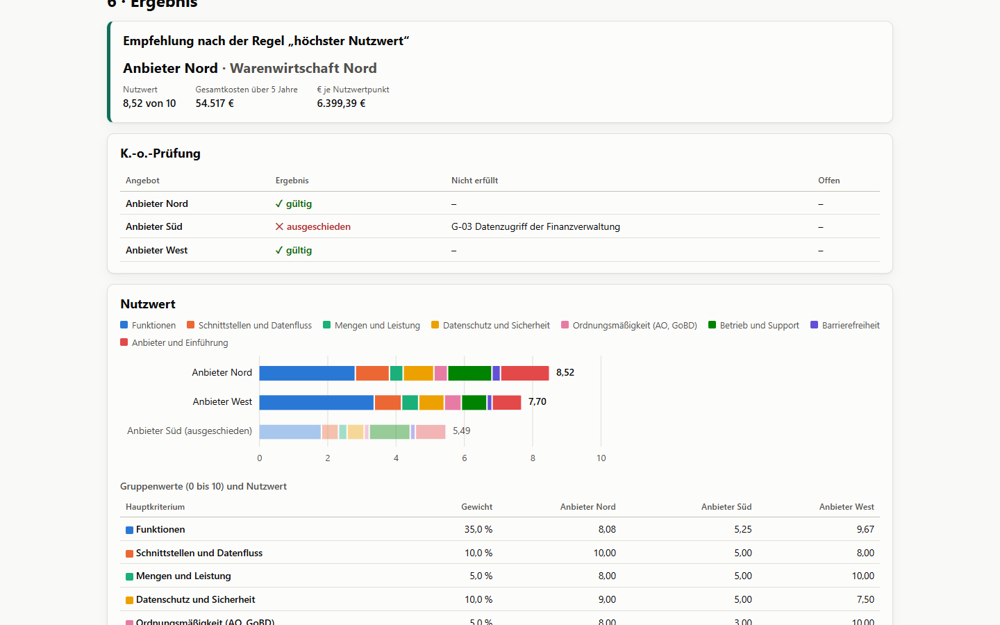
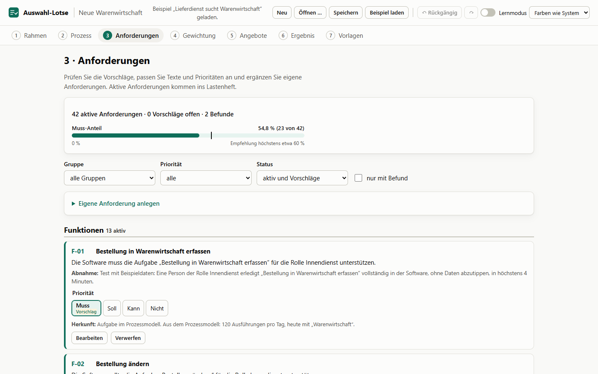
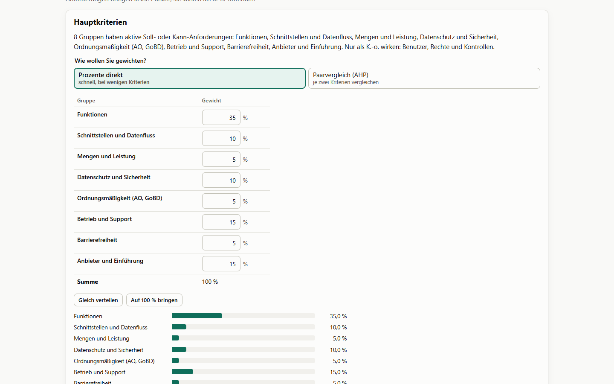
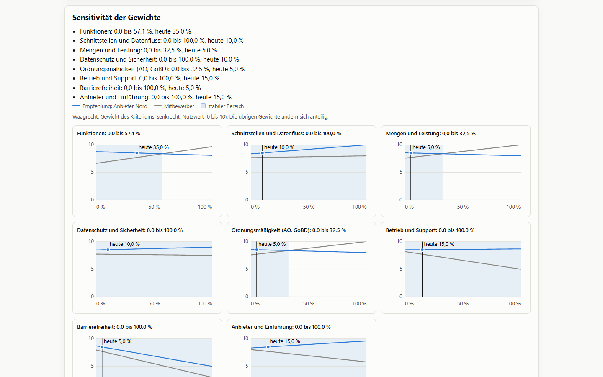
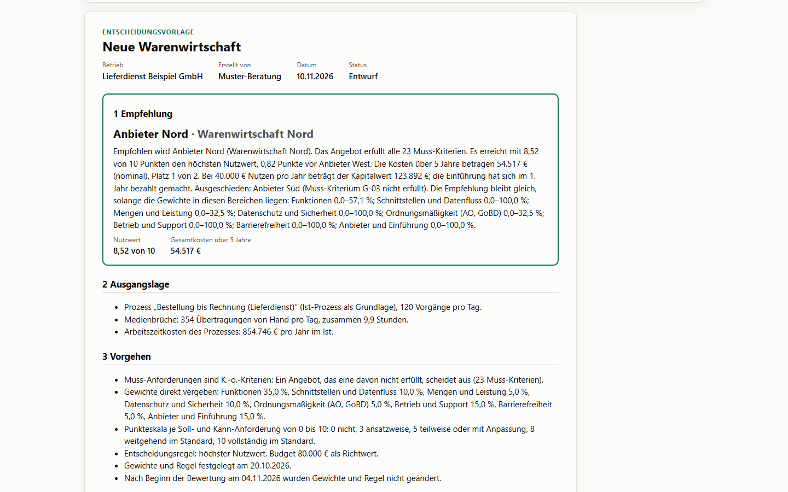

# Auswahl-Lotse

Vom Prozessmodell zu Lastenheft und begründeter Softwareentscheidung. Der Auswahl-Lotse liest ein Projekt des Prozesslotsen, leitet daraus ein Lastenheft mit MoSCoW-Prioritäten und Abnahmekriterien ab, gewichtet Kriterien direkt oder per Paarvergleich (AHP), prüft K.-o.-Kriterien, bewertet Angebote per Nutzwertanalyse, vergleicht die Kosten über mehrere Jahre und schreibt eine druckbare Entscheidungsvorlage. Läuft im Browser oder als Windows-Programm, ohne KI und ohne Server.

**[Für Windows herunterladen (Auswahl-Lotse-Setup.exe)](https://github.com/edgebird-lab/auswahllotse/releases/latest/download/Auswahl-Lotse-Setup.exe)** · Version 0.1.0 · [alle Versionen](https://github.com/edgebird-lab/auswahllotse/releases) · [Projektseite](https://olbricht-digital.de/software/auswahl-lotse)

> **Version 0.1.0 vom 11.11.2026:** die erste veröffentlichte Version. Alle sieben Schritte, Druckvorlagen, CSV-Fragebogen und das Windows-Programm sind fertig, getestet und gegen die Spezifikation geprüft. Eine Durchsicht an einem echten Auswahlverfahren steht noch aus. Fehler und Wünsche gern als [Issue](https://github.com/edgebird-lab/auswahllotse/issues).



## Installieren

- **Voraussetzung:** Windows 10 oder 11 (64 Bit) mit der Microsoft Edge WebView2 Runtime. Windows 11 bringt sie mit; fehlt sie (ältere Windows-10-Rechner), lädt der Installer sie von Microsoft nach. Dafür braucht er eine Internetverbindung, das Programm selbst nicht.
- **Pro Benutzer, ohne Admin-Rechte:** [`Auswahl-Lotse-Setup.exe`](https://github.com/edgebird-lab/auswahllotse/releases/latest/download/Auswahl-Lotse-Setup.exe) (etwa 1,3 MB) ausführen. Das Programm landet unter `%LOCALAPPDATA%\Auswahl-Lotse`, mit Eintrag im Startmenü und Verknüpfung „Auswahl-Lotse“ auf dem Desktop; `.auswahllotse`-Dateien öffnen sich per Doppelklick.
- **Nicht signiert:** Der Installer trägt noch keine Code-Signatur. Windows SmartScreen kann deshalb beim ersten Start warnen („Der Computer wurde durch Windows geschützt“); über „Weitere Informationen“ > „Trotzdem ausführen“ geht es weiter.
- **Aktualisieren und entfernen:** Es gibt keine automatischen Updates. Eine neue Version installiert man einfach über die alte; Projektdateien bleiben erhalten. Entfernen über Einstellungen > Apps.
- **Ohne Installation:** Die gleiche Oberfläche läuft auch im Browser, gebaut aus dem Quelltext (siehe [Aus dem Quelltext starten](#aus-dem-quelltext-starten)).

## Zusammenspiel mit dem Prozesslotsen

Der Auswahl-Lotse baut auf dem **Prozesslotsen** auf, einer weiteren App von olbricht-digital, mit der man Geschäftsprozesse über geführte Fragen modelliert. Er liest dessen Projekte (`.prozesslotse` oder `.json`, Formate 1 bis 3) und BPMN-Dateien mit eingebettetem Projekt. Aus Aufgaben, Rollen, Medienbrüchen und Mengen des Modells schlägt er Anforderungen, Prioritäten und Kostenannahmen vor. Die Prozesslotse-Datei bleibt dabei unverändert. Ohne Prozessmodell geht es auch: Dann beginnt das Lastenheft mit dem Katalog und eigenen Anforderungen. Zum Ausprobieren öffnet „Beispiel laden“ ein fertiges Fallbeispiel.

## Was es kann

Ein geführter Assistent in sieben Schritten:

1. **Rahmen:** Vorhaben, Betrieb, Softwareart (ERP, Shop, CRM, DMS, andere) und die Fragen, die den Katalog steuern: Daten über Personen, steuerlich wichtige Unterlagen, Betrieb in der Cloud oder auf eigenem Server, Verkauf an Verbraucher, Kleinstunternehmen. Dazu Betriebstage, Spitzenfaktor und Richtwerte für die Texte.
2. **Prozess:** Prozesslotse-Projekt (`.prozesslotse`, `.json`) in den Formaten 1 bis 3 oder eine BPMN-Datei mit eingebettetem Projekt einlesen. Unbekannte Bausteine neuerer Formate werden als allgemeiner Schritt übernommen und gemeldet. Umfang festlegen: je System „ablösen“, „anbinden“ oder „unberührt“, je Aufgabe im Umfang oder nicht. „Neu einlesen“ zeigt vorher, was sich ändert.
3. **Anforderungen:** Funktionen aus Aufgaben, Schnittstellen aus Medienbrüchen, Rollen, Freigaben und Prüfungen, Mengengerüst aus Vorgängen pro Tag; dazu 21 Katalogeinträge (DSGVO, AO, Betrieb, Barrierefreiheit, Anbieter) und 24 Bausteine je Softwareart, alle mit Quelle. Prüfungen mit festen Regeln: unbestimmte Begriffe, fehlende oder unpassende Modalverben, fehlende Abnahmekriterien, Muss-Anteil über 60 %.
4. **Gewichtung:** Hauptkriterien direkt in Prozent oder per Paarvergleich auf 17 Stufen mit Konsistenzprüfung (CR) und Hinweis auf das widersprüchlichste Urteil; Punkte innerhalb der Gruppen; Entscheidungsregel und Budget; „Festlegen“ mit Zähler für spätere Änderungen.
5. **Angebote:** Muss-Kriterien als K.-o. (erfüllt, nicht erfüllt, offen), Soll und Kann mit 0 bis 10 Punkten, Fundstelle und Notiz; Kosten mit einmaligen, laufenden und internen Posten, Vorschläge für Benutzer, Stundensatz und Nutzen aus dem Prozessmodell.
6. **Ergebnis:** Empfehlung nach „höchster Nutzwert“ oder „bestes Preis-Leistungs-Verhältnis“, K.-o.-Übersicht, Nutzwert und Kosten als Diagramm und Tabelle, Barwert, Kapitalwert und Amortisation, Sensitivität der Gewichte, alle Befunde mit Sprung zur Ursache.
7. **Vorlagen:** Lastenheft und Entscheidungsvorlage zum Drucken oder als PDF, Begründungsentwurf aus Textbausteinen, Risiken, Status „final“ erst ohne Fehler; Anbieterfragebogen als CSV.

Dazu: Rückgängig und Wiederholen, Lernmodus mit kurzen Erklärungen der Methoden, hell und dunkel, vollständig per Tastatur bedienbar.

| Anforderungen | Gewichtung |
| --- | --- |
|  |  |
| **Sensitivität** | **Entscheidungsvorlage** |
|  |  |

## Fallbeispiel „Lieferdienst sucht Warenwirtschaft“

Ein regionaler Lieferdienst mit 120 Bestellungen am Tag sucht ein ERP-System. Grundlage ist das Prozessmodell „Bestellung bis Rechnung“ aus dem Prozesslotsen. Das Projekt liegt als [`testdaten/beispiel-lieferdienst.auswahllotse`](testdaten/beispiel-lieferdienst.auswahllotse) bei und öffnet sich in der App mit „Beispiel laden“. Betrieb und Angebote sind erfunden. Die Vorlagen als PDF: [Lastenheft](docs/proben/lastenheft-lieferdienst.pdf), [Entscheidungsvorlage](docs/proben/entscheidungsvorlage-lieferdienst.pdf).

- **Lastenheft:** 42 aktive Anforderungen, davon 23 Muss (54,8 %). Aus dem Modell stammen 8 Funktionen, 2 Schnittstellen (Papier → Warenwirtschaft, Warenwirtschaft → Excel-Tourenliste), Rollen, eine Freigabe und das Mengengerüst; dazu der Katalog (DSGVO, AO, Betrieb, Anbieter) und die ERP-Bausteine.
- **Gewichte (direkt):** Funktionen 35 %, Betrieb und Support 15 %, Anbieter und Einführung 15 %, Schnittstellen 10 %, Datenschutz 10 %, Mengen 5 %, Ordnungsmäßigkeit 5 %, Barrierefreiheit 5 %.
- **Annahmen:** 5 Jahre, 7 Benutzer, interner Stundensatz 44 € (aus den Rollen), Preissteigerung 3 %, Zins 5 %, Nutzen 40.000 € pro Jahr (der Vorschlag aus den Medienbrüchen wäre 100.920 €), Budget 80.000 €.

| Angebot | Muss-Kriterien | Nutzwert | Gesamtkosten 5 Jahre | Kapitalwert | Ergebnis |
| --- | --- | --- | --- | --- | --- |
| Anbieter Nord, „Warenwirtschaft Nord“ (Cloud) | alle 23 erfüllt | 8,52 | 54.517 € | 123.892 € | **empfohlen**, bezahlt im 1. Jahr |
| Anbieter West, „West Komplett“ (eigener Server) | alle 23 erfüllt | 7,70 | 93.088 € | 86.200 € | Rang 2, über Budget |
| Anbieter Süd, „ERP Süd Start“ (Cloud) | G-03 nicht erfüllt | 5,49 | 35.230 € | – | ausgeschieden |

Anbieter Nord liegt 0,82 Punkte vorn und ist günstiger als West. Die Empfehlung kippt erst, wenn Funktionen mehr als 57,1 % des Gewichts bekämen (heute 35 %); dann läge West mit den stärkeren Funktionen vorn. Anbieter Süd ist am günstigsten, bietet aber keinen Datenzugriff für die Finanzverwaltung nach § 147 Abs. 6 AO und scheidet deshalb aus.

## Formeln (Auszug)

| Größe | Berechnung |
| --- | --- |
| Häufigkeit einer Aufgabe | erwartete Ausführungen je Vorgang nach dem Flussverfahren des Prozesslotsen; Wiederholung mit Anteil r läuft 1 / (1 − r)-mal |
| Medienbruch | Paar (Quelle, Ziel) einer Übertragung von Hand; Fall A bis E nach dem Status beider Systeme; Minuten pro Tag = Σ h · Minuten · V |
| Priorität aus dem Modell | Aufgabe mit h ≥ 0,5 je Vorgang → Muss, sonst Soll; Schnittstelle ab 60 Minuten pro Tag Muss, ab 10 Soll, sonst Kann |
| Muss-Anteil | Muss / (Muss + Soll + Kann) über aktive Anforderungen; Warnung über 60 % |
| Gruppenwert | S = Σ vᵢ · eᵢ / Σ vᵢ über die Soll- und Kann-Anforderungen der Gruppe (v = Punkte, e = Erfüllung 0 bis 10) |
| Nutzwert | N = Σ W_g · S_g, Wertebereich 0 bis 10; Muss-Anforderungen wirken nur als K.-o.-Kriterium |
| Paarvergleich | Eigenvektor per Potenzmethode, CR = CI / RI, stimmig bis 0,10 (RI nach Saaty 1987, per Simulation geprüft) |
| Gesamtkosten | E + Σ L_t mit E = einmalig + interne Einführung und Schulung, L_t = L₁ · (1 + s)^(t − 1) |
| Barwert, Kapitalwert | BW = E + Σ L_t / (1 + i)^t; KW = −E + Σ (U − L_t) / (1 + i)^t; Einführung in Jahr 0, laufende Kosten am Jahresende |
| Amortisation | kleinstes t mit Σ_{τ≤t} (U − L_τ) / (1 + i)^τ ≥ E |
| Sensitivität | ein Gewicht variieren, die übrigen proportional anpassen; stabiler Bereich, in dem die Empfehlung gleich bleibt; knapp unter 5 Prozentpunkten Abstand |

Alle Schwellen stehen mit Quelle in [`src/regeln/schwellen.ts`](src/regeln/schwellen.ts), die Kataloge mit Quelle und Stand in [docs/kataloge.md](docs/kataloge.md).

## Daten und Sicherheit

- **Alles lokal:** kein Server, keine KI, keine Telemetrie. Das Projekt liegt im Browser-Speicher dieses Geräts und als `.auswahllotse`-Datei, die Sie selbst speichern. „Browser-Speicher leeren“ im Fuß ist für gemeinsam genutzte Rechner gedacht.
- **Nichts geht still verloren:** Lässt sich der im Browser gesicherte Stand beim Start nicht lesen, bleibt er als Kopie erhalten; eine Meldung nennt den Grund und bietet „Kopie herunterladen“ an.
- **Beim Öffnen geprüft:** Projektdateien werden Feld für Feld geprüft (Typen, Auswahlwerte, eindeutige Kennungen); eine beschädigte Datei ergibt eine Meldung mit der Stelle, das geöffnete Projekt bleibt unverändert.
- **Inhaltsrichtlinie:** Der Build erlaubt nur eigene Dateien und keine Verbindungen nach außen (`connect-src 'none'`). Im Windows-Programm setzt Tauri eine ebenso enge Richtlinie, die nur die Verbindung zum eigenen Programmteil zulässt.
- **Windows-Programm:** Die Oberfläche hat keine allgemeinen Dateirechte. Geschrieben wird nur auf Pfade, die Sie selbst gewählt haben (Speichern unter, geöffnetes Projekt), und zwar über eine Hilfsdatei, damit ein Absturz keine halbe Datei hinterlässt. Prozesslotse- und BPMN-Dateien werden nur gelesen.
- **Eingaben:** Größen- und Tiefengrenzen beim Einlesen, BPMN mit DOCTYPE wird vor dem Parsen abgelehnt, eingelesene Daten werden Feld für Feld kopiert.
- **CSV:** Formelschutz für Felder, die Excel als Formel lesen würde.
- Dateiformat: [docs/datenmodell.md](docs/datenmodell.md).

## Bedienung

| Taste | Wirkung |
| --- | --- |
| Strg+S | Projekt speichern (im Programm an den bekannten Ort, sonst mit Rückfrage nach dem Ort) |
| Strg+Umschalt+S | Speichern unter |
| Strg+O | Projektdatei öffnen |
| Strg+N | Neues Projekt (nur im Programm) |
| Strg+Z, Strg+Y | Rückgängig, Wiederholen (außerhalb von Eingabefeldern) |

Prozesslotse-Dateien werden im Schritt „Prozess“ eingelesen, nicht über „Öffnen“. Im Programm geht das auch über „Datei > Prozessmodell einlesen …“, per „Öffnen mit“ oder durch Ziehen ins Fenster.

Zahlen versteht die App deutsch geschrieben: „1.234,50“, „1234,5“ und „90.000“ (Punkte in Dreiergruppen sind Tausendertrennzeichen). Ein einzelner Punkt ohne Dreiergruppe gilt als Dezimalpunkt („2.5“ ist 2,5). Nach Beginn der Bewertung zählt jede Änderung an Gewichten, Anforderungen oder Regel einmal, auch wenn man Ziffer für Ziffer tippt; die Entscheidungsvorlage nennt die Zahl.

## Aus dem Quelltext starten

Voraussetzung: Node 24. Keine globalen Installationen nötig.

```bash
npm install
npm run dev        # Entwicklungsserver, Adresse steht in der Ausgabe
npm run build      # Typprüfung und Build nach dist/
npm run preview    # gebaute App auf http://localhost:4183 (fester Port)
```

Im Browser „Beispiel laden“ öffnet das Fallbeispiel; ein eigenes Prozessmodell liest man im Schritt „Prozess“ ein (`.prozesslotse`, `.json` oder `.bpmn` mit eingebettetem Projekt).

Den Installer selbst bauen: einmal `npm run desktop:build` (dazu Rust stable), dann `Auswahl-Lotse_<Version>_x64-setup.exe` aus `…/release/bundle/nsis/` ausführen. Fertige Installer stehen unter [Releases](https://github.com/edgebird-lab/auswahllotse/releases). Einzelheiten unter [Windows-Programm](#windows-programm).

## Windows-Programm

Der Auswahl-Lotse läuft auch als Windows-Programm (Tauri 2 mit WebView2, App-ID `de.olbricht-digital.auswahllotse`). Gleiche Oberfläche, dazu:

- **Installation pro Benutzer ohne Admin-Rechte:** Der Installer (NSIS, deutsch) legt das Programm unter `%LOCALAPPDATA%\Auswahl-Lotse` ab, mit Eintrag im Startmenü und Verknüpfung „Auswahl-Lotse“ auf dem Desktop (siehe [Installieren](#installieren)). Bei einem Tag `v*` baut die CI den Installer und hängt ihn an einen Release-Entwurf, zusätzlich als `Auswahl-Lotse-Setup.exe` mit festem Namen für den Download-Link (`.github/workflows/release.yml`).
- **Dateien:** `.auswahllotse` öffnet sich per Doppelklick. Ein zweiter Doppelklick landet im laufenden Programm (eine Instanz). `.prozesslotse` und `.bpmn` werden nicht zugeordnet; man liest sie über den Dialog ein. Dateien lassen sich auch ins Fenster ziehen: Projekte werden geöffnet, Prozessmodelle eingelesen.
- **Menü „Datei“:** Neu, Öffnen, Prozessmodell einlesen, Speichern, Speichern unter, Anbieterfragebogen als CSV, Beispiel laden, Beenden. Beim Schließen mit ungespeicherten Änderungen fragt das Programm nach; „Nicht speichern“ verwirft sie auch für den nächsten Start.
- **PDF ohne Druckdialog:** In beiden Vorlagen schreibt „Als PDF speichern …“ die angezeigte Vorlage direkt über WebView2 als PDF (A4, 20 mm Rand). „Drucken …“ öffnet den Druckdialog.
- Programmdaten (zuletzt bearbeitetes Projekt, Einstellungen) liegen unter `%LOCALAPPDATA%\de.olbricht-digital.auswahllotse`.

Bauen und prüfen (Rust stable, z. B. per rustup; dazu Node 24):

```bash
cargo test --manifest-path src-tauri/Cargo.toml   # Rust-Tests (Argumente, atomares Speichern, Endungen, Erkennung)
npx tauri build --debug --no-bundle               # Debug-Programm für den Desktop-Test
npm run desktop:test                              # Desktop-Test ohne Installation (WebView2-Debugport 9335)
npm run desktop:build                             # Release mit Installer unter …/release/bundle/nsis/
npm run desktop                                   # Entwicklung mit Neuladen (Vite auf Port 5183)
```

Der Desktop-Test startet das echte Programm und steuert es über die Debug-Schnittstelle von WebView2. Dateidialoge beantwortet nur der Debug-Build über Umgebungsvariablen; im Release fehlt das. Weil ein installierter Auswahl-Lotse dieselben Programmdaten nutzt, benennt der Test sie vorher um und stellt sie danach wieder her; läuft der Auswahl-Lotse, bricht der Test ab. Die CI baut das Programm auf Windows, installiert es still, prüft Zuordnung und Verknüpfungen und deinstalliert es wieder (`src-tauri/windows/installer-test.ps1`).

## Tests

```bash
npm run lint       # oxlint (mit react/no-danger)
npm test           # Unit-Tests der Fachlogik (Vitest)
npm run e2e        # Browsertests mit Playwright und axe (lokal Edge, Port 4183 fest)
```

- **258 Unit-Tests in 28 Dateien:** alle Testwerte der Spezifikation (Abschnitt 9.1, von Hand nachgerechnet), dazu Randfälle wie Tausenderpunkt, Rundung an Halbwerten, doppelte Kennungen und unlesbarer Browser-Speicher. Das Fallbeispiel prüft auch die Zahlen dieser README.
- **22 Browsertests:** E1 bis E11 der Spezifikation, axe in allen Schritten und Reitern hell und dunkel, ganzer Durchlauf nur mit Tastatur, Speichern und Öffnen, beschädigter Browser-Speicher, Zahleneingabe mit Änderungszähler und Sprung von Befunden zur Ursache.
- **Windows-Programm:** 6 Rust-Tests und der Desktop-Test mit 48 Prüfungen am echten Programm (siehe [Windows-Programm](#windows-programm)).
- Vor jedem Commit laufen lint, Unit-Tests, Build und Browsertests. Der Port 4183 muss frei sein; ein laufender Vorschau-Server lässt `npm run e2e` abbrechen.

Bilder und PDF-Proben neu erzeugen: `npm run build`, dann `npx vite preview --port 4183 --strictPort` und `node scripts/readme-bilder.mjs`. Rundgang mit Bildschirmfotos: `node scripts/ansehen.mjs <ordner>`. Das Fallbeispiel neu schreiben: `npx vitest run -u src/beispiel`.

Aufbau: Fachlogik ohne React in `src/prozessdatei`, `src/modell`, `src/lastenheft`, `src/bewertung`, `src/kosten`, `src/entscheidung` und `src/export`; Oberfläche in `src/ui` mit Zustand in `src/zustand.ts` und Plattformschicht in `src/plattform`. Spezifikation in [docs/spezifikation.md](docs/spezifikation.md), Annahmen in [docs/entscheidungen.md](docs/entscheidungen.md).

## Stand

| Phase | Stand |
| --- | --- |
| 0 Einrichten | fertig; Repo und CI seit 11.11.2026 |
| 1 bis 7 Datenmodell, Einlesen, Lastenheft, Gewichtung, Kosten, Oberfläche, Vorlagen | fertig und getestet |
| 8 Qualität | Browsertests, Barrierefreiheit und Tastatur fertig; die kritische Prüfung vom 11.11.2026 hat elf Fehler und Schwächen gefunden und behoben (Liste in [docs/stand.md](docs/stand.md)). Version 0.1.0 am 11.11.2026 veröffentlicht (8.4); die Durchsicht an einem echten Fall (8.3) folgt |
| 9 Windows-Programm mit Tauri | fertig: Plattformschicht, Installer pro Benutzer, Zuordnung `.auswahllotse`, Einlese-Dialog, eine Instanz, atomares Speichern, PDF beider Vorlagen, Desktop-Test, Windows-Job und Release in der CI |

Offene Fragen der Spezifikation (Kataloginhalte, Festlegungen) gelten als Annahmen, bis Robin entscheidet: [docs/entscheidungen.md](docs/entscheidungen.md).

## Grenzen

- Keine Rechtsberatung: Rechtliche Anforderungen im Katalog sind Hinweise mit Quelle und Stand (11.11.2026).
- Der Auswahl-Lotse ändert keine Prozesslotse-Dateien. Änderungen am BPMN-Diagramm in anderen Werkzeugen sieht er nicht; er liest nur das eingebettete Projekt.
- Neuere Formate des Prozesslotsen werden mit Warnung gelesen; Aufgaben in Bausteinen, die der Auswahl-Lotse noch nicht kennt, fehlen im Lastenheft.
- Sensitivität: Bei der Regel „bestes Preis-Leistungs-Verhältnis“ bleibt der Mindestnutzwert in der Analyse fest. Ein Angebot, das ihn heute nicht erreicht, wird auch dann nicht betrachtet, wenn es ihn bei anderen Gewichten erreichen würde.
- Ein Prozessmodell je Vorhaben, ein Bewerter, kein Rücklauf des CSV-Fragebogens und keine Word-Datei; das folgt frühestens in 0.2.
- Änderungszähler: Eine Eingabe zählt wie ein Rückgängig-Schritt; wer beim Tippen länger als 1,5 Sekunden pausiert, erzeugt zwei Änderungen.
- Ein auf „final“ gesetzter Status bleibt stehen, wenn später Fehler hinzukommen; die App warnt dann, setzt ihn aber nicht selbst zurück.
- Im Browser: PDF nur über den Druckdialog, keine Rückfrage beim Schließen des Tabs (das Projekt liegt ohnehin im Browser-Speicher), kein Ablegen von Dateien per Ziehen.
- Windows-Programm: nicht signiert, keine automatischen Updates; nach einem Neustart kennt es den Pfad der zuletzt bearbeiteten Datei nicht mehr, Strg+S fragt dann einmal nach dem Ort.

## Rechte

© 2026 Robin Olbricht – olbricht-digital. Alle Rechte vorbehalten. Die Programme dürfen kostenlos genutzt werden; eine offene Lizenz ist noch nicht gewählt. Fremdbestandteile stehen unter ihren eigenen Lizenzen, siehe [docs/fremdlizenzen.md](docs/fremdlizenzen.md).

Die Namen im Fallbeispiel (Betrieb, Anbieter, Produkte) sind erfunden. Rechtliche Hinweise im Katalog sind keine Rechtsberatung.
